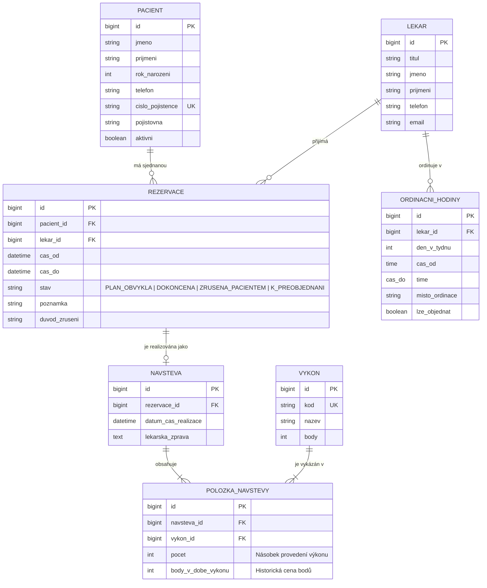

# Ordinace Na Vyhlídce – Rezervační a evidenční systém

> **Semestrální projekt předmětu Pokročilé programování (PPRO)**  
> **Fakulta informatiky a managementu, Univerzita Hradec Králové (ZS 2026/2027)**  
> **Vybrané zadání:** Zadání A – Rezervace v ordinaci  
> **Repozitář:** [https://github.com/dominikpalla/ppro2026.git](https://github.com/dominikpalla/ppro2026.git)  
> **Jediný zdroj pravdy (Single Source of Truth):** Tento soubor slouží jako autoritativní technická dokumentace, specifikace požadavků a přehled architektonických rozhodnutí.

---

## 1. Kontext a výchozí stav klienta

- **Klient:** MUDr. Jana Hrubá, *Ordinace Na Vyhlídce*.
- **Charakteristika provozu:** Soukromá praxe, 3 lékaři na částečný úvazek, recepční paní Věra. V kartotéce je zhruba 900 pacientů, z nichž polovina dochází na pravidelné kontroly.
- **Současný stav (problémy v praxi):**
  - Rezervace jsou vedeny ručně tužkou v papírovém diáři na recepci.
  - Hledání volných termínů probíhá zdlouhavým listováním během telefonátu s pacientem.
  - V případě nemoci lékaře musí recepce ručně dohledávat a obvolávat dotčené pacienty.
  - Na konci každého měsíce paní Věra tráví celý podvečer ručním přepisováním provedených výkonů do tabulky pro zdravotní pojišťovny.
  - Dochází k lidským chybám – opakovaně se stalo, že na stejný čas byli objednáni dva pacienti k jednomu lékaři.

---

## 2. Specifikace požadavků

### 2.1 Co klient chce (Funkční požadavky)
1. **Evidence pacientů:** Jméno, příjmení, rok narození, telefonní číslo, identifikátor pojištěnce (číslo pojištěnce / rodné číslo), zdravotní pojišťovna. Rychlé vyhledávání podle příjmení nebo telefonního čísla.
2. **Lékaři a ordinační hodiny:** Každý lékař má definované dny a časy ordinace. Systém musí reflektovat, že lékař může ordinovat i na externím pracovišti, kde objednávání v tomto systému neprobíhá.
3. **Rezervace na konkrétní termín:** Rezervaci zadává recepce na konkrétní čas k danému lékaři. Součástí rezervace je textová poznámka (důvod návštěvy).
4. **Záznam o návštěvě (realizace péče):** Při příchodu pacienta se zaznamená uskutečnění návštěvy a provedené výkony vybrané z oficiálního číselníku (kód výkonu, název, bodová hodnota). K jedné návštěvě lze přiřadit více výkonů (i s násobkem počtu provedení, např. 3× aplikace).
5. **Správa a statistika zrušených rezervací:** Možnost stornovat rezervaci s evidencí důvodu a přehled pacientů, kteří rezervace ruší opakovaně.
6. **Přehled volných termínů:** Klíčové zobrazení pro recepci – týdenní matice dostupných slotů pro vybraného lékaře.
7. **Měsíční výkaz pro pojišťovnu:** Automatický export a souhrn provedených výkonů a součtu vykázaných bodů za zvolený měsíc a lékaře.

### 2.2 Na čem klient trvá (Obchodní pravidla – striktně vynucená systémem)
- **Zákaz kolize termínů:** Dvě rezervace na stejný termín u téhož lékaře nesmí jít založit (vynuceno aplikační logikou i unikátním omezením v databázi).
- **Zákaz rezervace mimo ordinační hodiny:** Rezervaci nelze vytvořit v čase, kdy lékař na daném pracovišti neordinuje.
- **Integrita zápisu výkonů:** Lékařský výkon nelze přiřadit k návštěvě, která se ještě neuskutečnila (žádné budoucí ani plánované výkony).
- **Neměnnost historie pacienta:** Historické záznamy, uskutečněné návštěvy a výkony se nesmí mazat (ochrana zdravotnické dokumentace a auditní stopa).

### 2.3 Přání a ergonomické požadavky klienta
- **Maximální ergonomie a rychlost:** Systém musí být okamžitě ovladatelný paní Věrou bez zdlouhavého načítání stránek během příchozího hovoru.
- **Responzivní rozhraní:** Příprava pro pohodlné prohlížení na tabletu lékaře.
- **Architektonická otevřenost:** Možnost budoucího rozšíření o pacientský samoobslužný portál pro online rezervace.

---

## 3. Otevřené body a Seznam rozhodnutí (Decisions Log)

Dle metodiky předmětu PPRO jsou zde explicitně zdokumentována rozhodnutí ke všem 5 neuzavřeným bodům ze zadání:

### Rozhodnutí 1: Délka trvání termínu (Mřížka vs. individuální délka)
- **Problém klienta:** Neví, zda má být diář členěn do pevné 15minutové mřížky, nebo zda má mít každá rezervace libovolnou délku.
- **Rozhodnutí:** Základní mřížka kalendáře bude nastavena na **krok 15 minut**. Systém umožní rezervaci alokovat v násobcích tohoto kroku (výchozí délka 15 minut, s možností rozšíření na 30, 45 či 60 minut dle typu ošetření zadaného recepcí). Tím je zachován přehledný kalendář bez vzniku neprodejných časových fragmentů.

### Rozhodnutí 2: Role zakládající rezervaci (Recepce vs. Pacient)
- **Problém klienta:** Rozpory v tom, zda rezervace zadává výhradně recepce, nebo i pacienti přes internet.
- **Rozhodnutí:** V 1. fázi je zakládání rezervací vyhrazeno **pouze recepci (internímu personálu)**, což plně garantuje bezpečnost a eliminuje riziko podvodných zápisů. Aplikační servisní vrstva a API jsou však navrženy modulárně, aby v budoucnu umožnily připojení veřejného rozhraní pro pacienty přes samostatný zabezpečený kontroler.

### Rozhodnutí 3: Zrušené rezervace a statistika nespolehlivých pacientů
- **Problém klienta:** Požadavek, aby zrušená rezervace zmizela z diáře a termín byl volný, ale zároveň zůstala zachována statistika pacientů, kteří ruší termíny.
- **Rozhodnutí:** Rezervace využívá **stavový automat** (`PLAN_OBVYKLA`, `DOKONCENA`, `ZRUSENA_PACIENTEM`, `ZRUSENA_LEKAREM`). Při zrušení termínu přejde záznam do stavu `ZRUSENA_PACIENTEM`. Dotaz na volné sloty v diáři filtruje pouze aktivní (platné) rezervace, čímž se termín okamžitě uvolní pro nového pacienta. Původní záznam v databázi zůstává pro analytické dotazy na počet absencí.

### Rozhodnutí 4: Jednoznačná totožnost pacienta a prevence duplicit
- **Problém klienta:** V papírovém diáři figurují stejní pacienti vícekrát pod mírně odlišnými zápisy.
- **Rozhodnutí:** Jedinečným identifikátorem pacienta v databázi je **Číslo pojištěnce** (v ČR standardně odpovídá rodnému číslu). Systém aplikuje unikátní index na úroveň DB. V uživatelském rozhraní recepce je integrováno okamžité vyhledávání (našeptávač) podle jména a telefonu, které předchází pokusům o duplicitní zadávání.

### Rozhodnutí 5: Řešení nemoci lékaře
- **Problém klienta:** Jak naložit s termíny, když lékař nahlásí náhlou nepřítomnost.
- **Rozhodnutí:** Systém nabízí funkci **„Nahlásit nepřítomnost lékaře“** pro zadaný časový interval. Všechny dotčené rezervace jsou automaticky převedeny do stavu `K_PREOBJEDNANI` (čímž se uvolní kapacita v diáři) a recepční paní Věře se okamžitě vygeneruje **akční seznam pacientů k přednostnímu obvolání** včetně telefonních čísel a poznámek.

---

## 4. Architektura a technický návrh

Projekt striktně dodržuje povinné minimum předmětu PPRO:
- **Třívrstvá architektura:** Jednosměrné toky závislostí:
  - *Prezentační vrstva:* Web UI / REST API kontrolery, validace vstupních DTO.
  - *Aplikační a doménová vrstva:* Aplikační služby (Services), byznys pravidla, transakční meze.
  - *Perzistentní vrstva:* Relační schéma, ORM/Repozitáře, databázové migrace.
- **Relační databáze:** PostgreSQL v Docker kontejneru.
- **Správa schématu:** Verzované migrace pro čistou reprodukovatelnost.
- **Spouštění:** Kompletní běh aplikace zajištěn příkazem `docker compose up`.
- **Testování:** Sada integračních a jednotkových testů validujících klíčová obchodní pravidla.

### 4.1 Doménový model a entity (Minimálně 5 entit + M:N)



*Vazba M:N:* Realizována mezi entitami **`NAVSTEVA`** a **`VYKON`** prostřednictvím vazební entity **`POLOZKA_NAVSTEVY`**, která nese klíčový atribut `pocet` (např. 3× aplikace) a fixované body v době uskutečnění.

---

## 5. Spuštění a vývojové instrukce

### Požadavky
- Docker & Docker Compose
- Git

### Spuštění projektu
```powershell
docker compose up --build
```

### Spuštění testů
Testovací sada ověřuje zejména:
1. Zákaz překryvu dvou rezervací u stejného lékaře.
2. Zákaz objednání mimo ordinační hodiny nebo na externím pracovišti.
3. Nemožnost přiřadit výkon k plánované nebo zrušené rezervaci.
4. Výpočet měsíčního bodového výkazu lékaře.

---

## 6. Záznam o postupu vývoje (Progress Log)

| Datum | Verze / Krok | Popis změny | Autor |
| :--- | :--- | :--- | :--- |
| **2026-09-30** | `0.1.0-init` | Inicializace git repozitáře, napojení na remote GitHub origin, vytvoření `AGENTS.md` (zásady agenta) a `README.md` (kompletní technická dokumentace a decisions log pro Zadání A). | Vývojový tým |
